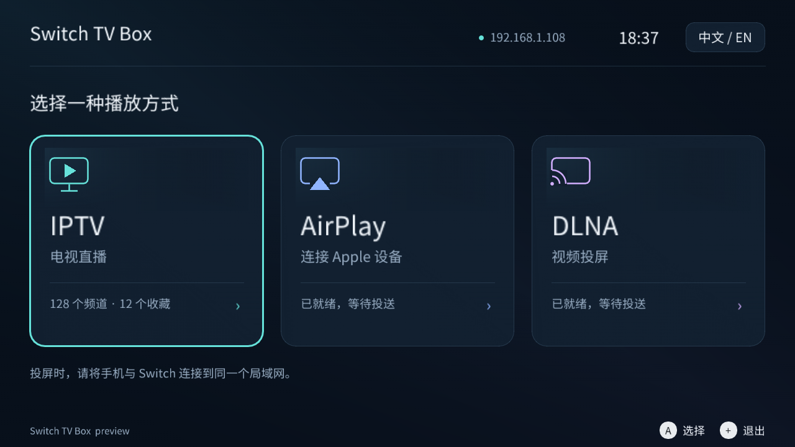

# Switch TV Box

把 Nintendo Switch 变成客厅电视盒子：电视直播、手机投屏、AirPlay 音乐与照片，共用硬件加速播放器。

本项目基于 [NX-Cast](https://github.com/Ode1l/NX-Cast) 0.3.2，保留其 DLNA、IPTV、配对镜像与播放器，在此基础上增加传统 AirPlay 1 音频和照片，重新设计电视界面。原项目及第三方许可证完整保留。



*由实际 ImGui 绘制代码生成的预览，图中 IP、频道和时间为样例数据。*

## 功能

- 首页只保留 **IPTV、AirPlay、DLNA** 三个入口，默认中文，支持手柄和触摸。
- IPTV 支持 M3U/M3U8、分类、搜索、EPG；播放中可呼出频道列表切台，收藏栏目保存到 SD 卡。
- IPTV 播放设置提供原画／均衡／流畅与 6／30／60 秒起播缓冲，默认选择 60 秒缓冲，后台最多预读 180 秒；画质选择取决于片源是否提供多码率版本，详见 [播放说明](docs/iptv.md#playback-quality-and-buffering)。
- DLNA 视频投屏，接收手机应用发送的视频地址，支持播放、暂停、停止，以及可定位视频的进度跳转；[投屏指南与实现说明](docs/DLNA.md)记录了参考 wiliwili 的修复与验证范围。
- AirPlay 1 RAOP：RSA/AES、ALAC/AAC/PCM、UDP 音频、音量、FLUSH、重传和实际音频输出链路。
- AirPlay 1 照片：JPEG/PNG、预缓存、缓存显示；在播放器中保持显示至停止或替换。
- 保留 URL/HLS 视频、PIN 配对和带声音的屏幕镜像；音乐和照片统一归入 AirPlay 入口。

协议、真实编解码、生命周期和界面已有主机测试；Switch 交叉编译与 SD 安装包已通过，[本次验证记录](docs/VALIDATION.md)包含结果和产物校验值。**尚未完成物理 Switch 与各代 iOS/macOS 的互操作验收，不能称为“完美支持所有 AirPlay 1”。** 老式 `/stream` 镜像、服务器幻灯片/转场、歌曲封面显示等仍有明确缺口，详见 [AirPlay 1 能力与验证](docs/AIRPLAY1.md)。

## 安装与使用

构建产物为 `dist/switch-tv-box-sdmc.zip`。解压到 Switch SD 卡根目录，保留以下结构：

```text
switch/switch-tv-box/
  switch-tv-box.nro
  dlna/
  fonts/
  iptv/sources.txt
  airplay/
  licenses/
```

Release 同时提供 `switch-tv-box-v0.1.1-complete.zip`，包含 `sdmc/` 安装目录、
`source/` 完整已提交源码与离线规范、`manifest.json` 构建标识。安装时复制
`sdmc/` 里面的内容到 SD 卡根目录；下载完整性可用 `SHA256SUMS.txt` 核对。

使用 Atmosphère/homebrew 环境，推荐完整应用模式启动。手机与 Switch 连接同一局域网，在支持 AirPlay 的应用中选择 **Switch TV Box**。镜像需要配对时，输入电视上显示的 PIN。

**在 Eden 中运行需要额外的模拟器配置。** 下载的 NRO 包含图形界面，但只打开 NRO
不会创建 Eden 兼容标记；缺少标记时，Eden 0.2.1 可能停在 `QUICK START` /
`PLAYER CONTROLS` 英文文字界面。请按 [Eden 启动与文字界面排查](docs/EMULATOR.md#eden-中只显示英文文字界面)
配置模拟 SD，或使用本项目的 `scripts/run-eden.py` 自动准备。实体 Switch 无需该标记。

Windows / Eden 的手机投屏发现使用 [自动组播组件](docs/EDEN-WINDOWS.txt)：
运行 `Switch-TV-Box-Discovery.exe` 后自动识别物理网卡和接收器，发布 AirPlay 与 DLNA，
无需手填 IP。组播仅在网络允许互访的局域网内工作。

直播源可以放入 `switch/switch-tv-box/iptv/`，也可在频道库的直播源管理中添加。配置目录与 NX-Cast 分开；要迁移直播源，请复制原 `iptv/` 下自己的配置文件。AirPlay 身份与配对记录由本机生成，不随安装包分发。

| 操作 | 按键 |
|---|---|
| 首页选择 / 确认 | 方向键或摇杆 / A |
| 打开频道库（含播放中） | X 或按下摇杆 |
| 频道列表中切台 | 方向键选择、A 播放、B 收起列表 |
| 收藏 / 取消收藏 | 频道列表选中频道后按 Y |
| 查看收藏频道 | 频道列表顶部选择“收藏” |
| 调整画质与缓冲 | 频道列表顶部选择“播放设置”，保存后重播当前频道 |
| 返回正在播放的画面 | 首页按 B，或在投屏页面选择播放控制 |
| AirPlay 音乐暂停 / 继续 | AirPlay 页面选择播放控制后按 A |
| 播放画面暂停 / 跳转 / 音量 | A / 左右或 L、R / 上下 |
| 返回首页 / 退出 | B / + |

首页按钮也支持触摸。单 Joy-Con、Pro Controller 和掌机控制沿用上游逻辑。

## 本地开发

优先复用本机 `netease-switch/toolchain:local` Docker 镜像，并建立独立媒体工具链，不改动原镜像。没有该镜像时使用固定摘要的 devkitPro 基础镜像。

```sh
./scripts/build-local.sh image
./scripts/build-local.sh release
```

只跑测试：`./scripts/build-local.sh test`。只编译和打包：`./scripts/build-local.sh build`。VS Code 默认构建任务使用 Docker。完整说明见 [构建指南](docs/BUILD.md)。

使用本机已有 Eden 在独立虚拟桌面运行实际 NRO：见 [模拟器启动与兼容说明](docs/EMULATOR.md)，包括独立 SD 配置、兼容 SDK 和局域网发现助手。

生成二十一种真实 UI 预览：`python3 scripts/preview_home.py`，输出到 `artifacts/ui/`。

## 本地规范与来源

[AirPlay 规范离线入口](docs/reference/airplay-spec/index.html)已包含全部站点章节、打印版、搜索索引、脚本、样式、字体及源码/二进制示例；可离线浏览。下载清单和 SHA-256 见 [归档说明](docs/reference/README.md)。

- 上游基线：NX-Cast `0efdba4281122cdd97de0c3c1a7ebde7485d6d15`。
- 许可证：[GPL-3.0](LICENSE)，第三方来源见 [NOTICE](third_party/NOTICE.md)。
- 上游原始介绍保存在 [docs/upstream](docs/upstream/)。其他继承的历史文档和 plans 可能仍使用 NX-Cast 名称，以本 README、BUILD.md、AIRPLAY1.md 为当前版本说明。
- 本工具不提供 DRM 绕过，不支持 AirPlay 2 多房间或 Apple 认证。
